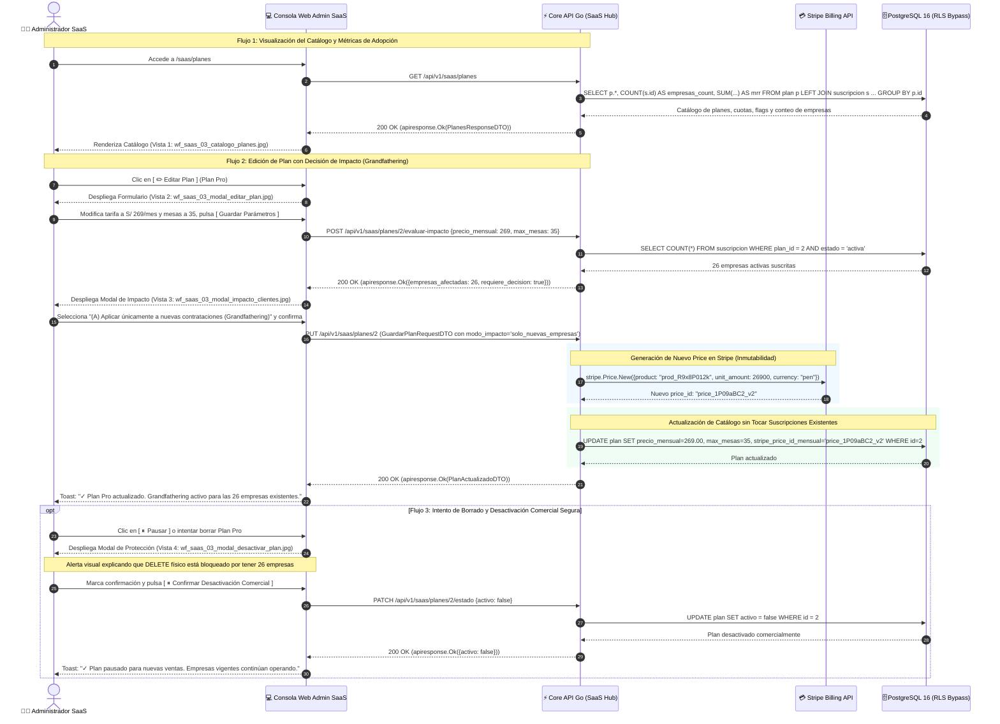

# Especificación Técnica y Wireframes: CU-SAAS-03: Configurar Planes de Suscripción

## 1. Ficha Técnica del Caso de Uso

| Atributo | Detalle |
| :--- | :--- |
| **Código** | `CU-SAAS-03` |
| **Nombre** | **Configurar planes de suscripción** (Gestión Centralizada de Tarifas, Cuotas Operativas, Módulos y Políticas de Impacto Comercial) |
| **Rol / Actor** | **Administrador Global SaaS** (`admin_saas`) |
| **Módulo** | Administración Central SaaS / Tenancy, Facturación & Catálogo Comercial |
| **Objetivo de Negocio** | Proveer al operador de la plataforma una consola formal para: (1) supervisar el catálogo de planes comerciales y privados B2B con sus métricas de adopción y MRR generado; (2) crear y ajustar tarifas periódicas (mensual/anual en Soles), cuotas cuantitativas por sede (locales, pisos, mesas, personal) y habilitación de módulos del sistema (reservas, reportes avanzados, asistente IA, predicción IA); (3) gestionar con **garantía de cero roturas** el impacto de cambios en clientes existentes (*Grandfathering* respetando precios pactados vs *Propagación Global* en próxima renovación); (4) proteger la base de datos contra eliminaciones físicas destructivas (`DELETE`), canalizando a desactivación comercial segura (`activo = false`); y (5) emitir respuestas bajo el estándar canónico `apiresponse.Response` y errores tipificados de `apierror`. |
| **Precondiciones** | El usuario cuenta con sesión activa autenticada con rol `admin_saas` (`empresa_id = NULL`, `local_id = NULL`). Existen planes base registrados en la base de datos (Starter, Pro, Enterprise). |
| **Postcondiciones** | Registro o actualización en la tabla `plan`; sincronización con objetos de producto y precio en Stripe Billing; preservación intacta de las cuotas de clientes suscritos; emisión de eventos de auditoría y respuestas formateadas con `apiresponse.Response`. |
| **Tokens de Diseño** | Grayscale Blueprint: `#0F172A` (Primario / Slate Dark), `#1E293B` (Superficie), `#F8FAFC` (Canvas), `#FFFFFF` (Card), `#E2E8F0` (Bordes), `#0F172A` (Texto Principal), `#64748B` (Texto Muted), `#15803D` (Verde Activo / Descuento Anual), `#B45309` (Ámbar Advertencia / Privado B2B), `#991B1B` (Rojo Bloqueo / Eliminar). |
| **Resolución Canónica** | `1440x900` px (Desktop Blueprint, JPG calidad 95). |

### Reglas de Negocio y Arquitectura de Cero Roturas (*Zero-Breakage*)

1. **Línea Base del Catálogo Canónico:**
   - **Plan Starter (S/ 99.00/mes — S/ 990/año):** 1 Local único, 1 Piso, **hasta 25 Mesas** de salón, hasta 5 cuentas de personal. **Sin módulo de reservas** (`incluye_reservas = false`), sin reportes avanzados ni IA. Orientado a cafeterías y dark kitchens.
   - **Plan Pro (S/ 249.00/mes — S/ 2,490/año):** Hasta 3 Locales, 2 Pisos por local, **hasta 30 Mesas** por local, hasta 15 cuentas de personal. Incluye Reservas de salón ([`CU-ADMIN-10`](file:///j:/proyectos_git/RestaurantCloud_AI_backend/wireframe/administrador/CU-ADMIN-10-politicas-reservas/wireframe.md)), Reportes Avanzados y Asistente IA de Salón. Sin predicción IA.
   - **Plan Enterprise (S/ 499.00/mes — S/ 4,990/año):** Hasta 10 Locales, 5 Pisos por local, **hasta 60 Mesas** por local, hasta 40 cuentas de personal. Incluye Reservas, Reportes Avanzados, Asistente IA y **Predicción de Demanda IA (Forecasting multi-sede)**.
   - **Planes Privados / Ocultos (`visible_publico = false`):** Planes bonificados o corporativos (ej. "Piloto Cadenas B2B", "Convenio Franquicias") ocultos del catálogo web y de la pasarela pública ([`CU-PROP-01`](file:///j:/proyectos_git/RestaurantCloud_AI_backend/wireframe/propietario/CU-PROP-01-registro-empresa/wireframe.md)), asignables exclusivamente por el `admin_saas` en [`CU-SAAS-01`](file:///j:/proyectos_git/RestaurantCloud_AI_backend/wireframe/saas_admin/CU-SAAS-01-supervisar-tenants/wireframe.md).

2. **Prohibición Total de Eliminación Física (`DELETE RESTRICT`):**
   - Un plan que tenga empresas asociadas en `suscripcion.plan_id` o `empresa.plan_id`, o registros de facturación histórica en `pago.plan_id`, **NUNCA puede ser eliminado físicamente de PostgreSQL**.
   - El endpoint `DELETE /api/v1/saas/planes/:id` valida la existencia de dependencias y rechaza la acción con `409 Conflict: ERR_PLAN_TIENE_EMPRESAS_ACTIVAS`.
   - En su lugar, el administrador ejecuta la **Desactivación Comercial (`activo = false`)**: el plan se oculta del autoservicio público, pero las empresas vigentes continúan operando con total normalidad, preservando la integridad referencial ACID. La eliminación física solo se permite para planes recién creados con `0` empresas y `0` pagos.

3. **Salvaguarda de Recursos Preexistentes ante Reducción de Límites:**
   - Si el administrador reduce una cuota en un plan activo (ej. baja `max_mesas` de 30 a 20):
     - **Nunca se borran mesas ni se expulsan usuarios existentes automáticamente.**
     - Los recursos actuales del restaurante permanecen 100% operativos.
     - Se bloquea la creación de *nuevos* recursos por encima del nuevo límite (`COUNT(mesas) >= max_mesas`).
     - Se emite una alerta pedagógica en el panel del propietario (`CU-PROP-02`) informando que se ha alcanzado la cuota y sugiriendo regularizar o ampliar plan.

4. **Inmutabilidad de Tarifas en Stripe y Grandfathering:**
   - En Stripe Billing, los objetos `Price` son inmutables.
   - Si el admin edita tarifas de un plan y selecciona **"Aplicar únicamente a nuevas contrataciones" (Grandfathering)**: el backend genera un nuevo `price_id` en Stripe para nuevos registros en `CU-PROP-01`. Las suscripciones existentes conservan su `price_id` anterior, respetando la tarifa histórica pactada.
   - Si selecciona **"Actualizar empresas existentes"**: el backend actualiza las suscripciones de los clientes con `proration_behavior = 'none'`, aplicando la nueva tarifa recién en la fecha de su siguiente ciclo de facturación.

5. **Formato Estándar de Respuesta y Errores (@context/mock.md):**
   - Todas las respuestas de la API envuelven la carga en `apiresponse.Response{Exito, Datos, Errores, Meta}`.
   - Todo fallo utiliza los errores tipificados de `apierror` (`PLAN_NO_ENCONTRADO`, `PLAN_TIENE_EMPRESAS_ACTIVAS`, `PRECIO_INVALIDO`, `LIMITES_INVALIDOS`, `NOMBRE_PLAN_DUPLICADO`).

---

## 2. Diagrama de Secuencia Mermaid



---

## 3. Especificación de Pantallas y Wireframes Blueprint

### Vista 1: Catálogo y Gestión de Planes SaaS (`wf_saas_03_catalogo_planes.jpg`)

Bandeja principal con métricas globales del catálogo comercial, pestañas de segmentación (públicos vs privados) y grid de 4 tarjetas de planes con tarifas, cuotas y métricas de adopción.

```
+------------------------------------------------------------------------------------------------------------------------+
| RESTAURANTCLOUD AI   [ CONSOLA ADMIN SAAS ]                     https://admin.restaurantcloud.pe/saas/planes  Admin Root  PRODUCCIÓN |
+------------------------------------------------------------------------------------------------------------------------+
|                                                                                                                        |
| Catálogo y Configuración de Planes de Suscripción                                            [ ➕ Crear Nuevo Plan ]    |
| Definición centralizada de tarifas en Soles (PEN), cuotas operativas por sede y módulos comerciales (Tabla `plan`)    |
|                                                                                                                        |
| +-------------------------+ +-------------------------+ +-------------------------+ +-------------------------+        |
| | PLANES EN CATÁLOGO    📦| | EMPRESAS SUSCRITAS    🏢| | MRR TOTAL CATÁLOGO    💵| | PLAN LÍDER EN ADOPCIÓN 🏆|        |
| | 3 Públicos + 1 B2B      | | 48 Cuentas              | | S/ 11,450.00            | | Plan Pro (54.2%)        |        |
| | Starter, Pro, Enterprise| | Base instalada total    | | Ingreso mensual recurr. | | 26 restaurantes activos |        |
| +-------------------------+ +-------------------------+ +-------------------------+ +-------------------------+        |
|                                                                                                                        |
| [ Todos los Planes (4) ] [ Públicos Web (3) ] [ Privados / Ocultos B2B (1) ]            [ 🔄 Sincronizar Catálogo ]    |
|                                                                                                                        |
| +------------------------+ +------------------------+ +------------------------+ +------------------------+          |
| | ● ACTIVO   ID #1 PUBLIC| | ● ACTIVO    ★ POPULAR  | | ● ACTIVO   ID #3 PUBLIC| | 🔒 PRIVADO B2B   OCULTO|          |
| | Starter                | | Pro                    | | Enterprise             | | Piloto Cadenas B2B     |          |
| | S/ 99.00 / mes         | | S/ 249.00 / mes        | | S/ 499.00 / mes        | | S/ 0.00 / 60 días      |          |
| | S/ 990 / año (Ahorra S/) | S/ 2,490 / año (Ahorra)  | | S/ 4,990 / año (Ahorra) | | Bonificado (Convenio)  |          |
| | Cafeterías y locales 1 | | Restaurantes y poller. | | Franquicias y cadenas  | | Para franquicias piloto|          |
| |                        | |                        | |                        | |                        |          |
| | ✓ 1 Sede (Local único) | | ✓ Hasta 3 Sedes        | | ✓ Hasta 10 Sedes       | | ✓ Hasta 2 Sedes prueba |          |
| | ✓ 1 Piso por sede      | | ✓ 2 Pisos por sede     | | ✓ 5 Pisos por sede     | | ✓ 2 Pisos por sede     |          |
| | ✓ Hasta 25 Mesas salón | | ✓ Hasta 30 Mesas salón | | ✓ Hasta 60 Mesas salón | | ✓ Hasta 40 Mesas salón |          |
| | ✓ Hasta 5 Personal     | | ✓ Hasta 15 Personal    | | ✓ Hasta 40 Personal    | | ✓ Hasta 20 Personal    |          |
| | ✕ Sin Módulo Reservas  | | ✓ Módulo Reservas      | | ✓ Módulo Reservas      | | ✓ Reservas + Reportes  |          |
| | ✕ Sin Reportes Avanz.  | | ✓ Menú Engineering     | | ✓ Reportes Avanzados   | | ✕ Sin Predicción IA    |          |
| | ✕ Sin Asistente IA     | | ✓ Asistente IA         | | ✓ Asistente IA         | |                        |          |
| | ✕ Sin Predicción IA    | | ✕ Sin Predicción IA    | | ✓ Predicción Demanda IA| |                        |          |
| |                        | |                        | |                        | |                        |          |
| | Adopción: 15 Empresas  | | Adopción: 26 Empresas  | | Adopción: 7 Empresas   | | Adopción: 0 Empresas   |          |
| | MRR: S/ 1,485.00       | | MRR: S/ 6,474.00       | | MRR: S/ 3,493.00       | | Borrador editable      |          |
| | [ ✏️ Editar ] [ ⏸ ]    | | [ ✏️ Editar Plan ] [ ⏸]| | [ ✏️ Editar ] [ ⏸ ]    | | [ ✏️ Editar ] [ 🗑️ ]   |          |
| +------------------------+ +------------------------+ +------------------------+ +------------------------+          |
|                                                                                                                        |
+------------------------------------------------------------------------------------------------------------------------+
```

#### Componentes Clave de la Vista 1:
- **4 Tarjetas de Métricas:** Universo de planes configurados, total de restaurantes suscritos (48), MRR global generado y plan líder en adopción (*Plan Pro con 26 empresas*).
- **Segmentación por Visibilidad:** Tabs para alternar entre planes públicos ofrecidos en la web ([`CU-PROP-01`](file:///j:/proyectos_git/RestaurantCloud_AI_backend/wireframe/propietario/CU-PROP-01-registro-empresa/wireframe.md)) y planes privados/ocultos creados para convenios B2B.
- **Card Plan Starter (Línea Base):** S/ 99/mes, **hasta 25 mesas**, local único, sin reservas ni módulos de inteligencia artificial.
- **Card Plan Pro (Destacado):** S/ 249/mes, hasta 3 sedes, 30 mesas, con reservas, reportes y asistente IA.
- **Card Plan Enterprise:** S/ 499/mes, hasta 10 sedes, 60 mesas, suite completa con predicción de demanda IA.
- **Card Plan Privado B2B:** Badge `🔒 Privado B2B (Oculto)`, tarifa bonificada y botón para borrado físico permitido al tener 0 empresas asociadas.

---

### Vista 2: Modal de Configuración y Edición de Plan (`wf_saas_03_modal_editar_plan.jpg`)

Formulario estructurado y compacto para ajustar parámetros comerciales y cuotas operativas sin scrollbar.

```
+------------------------------------------------------------------------------------------------------------------------+
| RESTAURANTCLOUD AI   [ CONSOLA ADMIN SAAS ]             https://admin.restaurantcloud.pe/saas/planes/2/editar  Admin Root  PRODUCCIÓN |
+------------------------------------------------------------------------------------------------------------------------+
|                                                                                                                        |
|       +--------------------------------------------------------------------------------------------------------+       |
|       | Configuración y Parámetros del Plan: Plan Pro Gastronómico                                        [ X ]|       |
|       | Ajuste de tarifas comerciales en Soles (PEN), cuotas operativas y módulos (Tabla `plan`)                |       |
|       +--------------------------------------------------------------------------------------------------------+       |
|       | NOMBRE DEL PLAN *                                        IDENTIFICADOR ÚNICO (SLUG / CÓDIGO) *         |       |
|       | [ Pro Gastronómico                                    ]  [ plan-pro                       (bloqueado) ]|       |
|       |                                                                                                        |       |
|       | DESCRIPCIÓN COMERCIAL BREVE                                                                            |       |
|       | [ Para restaurantes consolidados, cevicherías y pollerías de alta rotación con hasta 3 locales.       ]|       |
|       |                                                                                                        |       |
|       | +----------------------------------------------------------------------------------------------------+ |       |
|       | | VISIBILIDAD COMERCIAL                                                                              | |       |
|       | | [X] VISIBLE PÚBLICAMENTE EN WEB Y AUTOSERVICIO STRIPE CHECKOUT (`CU-PROP-01`)                      | |       |
|       | |     Si se desmarca (`visible_publico = false`), el plan será privado B2B y solo asignable en CU-01. | |       |
|       | +----------------------------------------------------------------------------------------------------+ |       |
|       | TARIFAS COMERCIALES EN SOLES (PEN)                                                                     |       |
|       | PRECIO MENSUAL ESTÁNDAR (S/ PEN) *                       PRECIO ANUAL CON DESCUENTO (S/ PEN) *         |       |
|       | [ S/ 249.00                                           ]  [ S/ 2,490.00         ] [✓ 2 Meses Gratis]    |       |
|       |                                                                                                        |       |
|       | LÍMITES CUANTITATIVOS MÁXIMOS POR EMPRESA                                                              |       |
|       | MÁX. LOCALES / SEDES *       MÁX. PISOS POR SEDE *       MÁX. MESAS POR SEDE *     MÁX. PERSONAL *     |       |
|       | [ 3                  ]       [ 2                 ]       [ 30                ]     [ 15          ]     |       |
|       |                                                                                                        |       |
|       | MÓDULOS DEL SISTEMA HABILITADOS                                                                        |       |
|       | +----------------------------------------------------------------------------------------------------+ |       |
|       | | [X] Módulo de Reservas de Salón (CU-ADMIN-10 / 05)    [X] Reportes Avanzados & Menú Engin. (CU-13) | |       |
|       | | [X] Asistente IA de Salón                             [ ] Predicción de Demanda IA (Forecasting)   | |       |
|       | +----------------------------------------------------------------------------------------------------+ |       |
|       | [i] Integridad y Detección de Impacto: Este plan tiene 26 empresas activas suscritas. Al presionar     |       |
|       |     "Guardar", el sistema evaluará si los cambios aplican a nuevos clientes o se propagan a actuales. |       |
|       +--------------------------------------------------------------------------------------------------------+       |
|       |  [ Cancelar ]                                                    [ Guardar Parámetros del Plan → ]     |       |
|       +--------------------------------------------------------------------------------------------------------+       |
|                                                                                                                        |
+------------------------------------------------------------------------------------------------------------------------+
```

#### Componentes Clave de la Vista 2:
- **Identificadores Inmutables:** Nombre comercial editable con validación única, código interno (`plan-pro`) bloqueado para evitar romper slugs de frontend.
- **Control de Visibilidad (`visible_publico`):** Switch interactivo para decidir si el plan es público o privado B2B.
- **Tarifas con Validación Inteligente:** Cálculo automático del ahorro anual equivalente a 2 meses bonificados.
- **Cuotas Operativas:** Campos numéricos para sedes, pisos, mesas y usuarios de personal.
- **Switches de Módulos del Sistema:** Activación/desactivación booleana de módulos core.

---

### Vista 3: Modal de Impacto en Clientes Existentes — Grandfathering vs Propagación (`wf_saas_03_modal_impacto_clientes.jpg`)

Diálogo crítico que previene roturas de contratos o facturación imprevista a los 26 restaurantes suscritos.

```
+------------------------------------------------------------------------------------------------------------------------+
| RESTAURANTCLOUD AI   [ CONSOLA ADMIN SAAS ]    https://admin.restaurantcloud.pe/saas/planes/2/confirmar-impacto  Admin Root  PRODUCCIÓN |
+------------------------------------------------------------------------------------------------------------------------+
|                                                                                                                        |
|       +--------------------------------------------------------------------------------------------------------+       |
|       | ⚠️ Decisión de Impacto: El Plan Pro cuenta con 26 Empresas Activas                                 [ X ]|       |
|       | Se detectaron modificaciones de tarifas y cuotas. Seleccione la política de propagación comercial:     |       |
|       +--------------------------------------------------------------------------------------------------------+       |
|       | RESUMEN DE MODIFICACIONES DETECTADAS                                                                   |       |
|       | +----------------------------------------------------------------------------------------------------+ |       |
|       | | PARÁMETRO CONFIGURADO    VALOR ANTERIOR (VIGENTE)    NUEVO VALOR PROPUESTO     IMPACTO EN CLIENTES | |       |
|       | | Tarifa Mensual (S/ PEN)  ~~S/ 249.00 / mes~~         [ S/ 269.00 / mes ]       Incremento +S/ 20.00| |       |
|       | | Tarifa Anual (S/ PEN)    ~~S/ 2,490.00 / año~~       [ S/ 2,690.00 / año ]     Incremento +S/ 200.0| |       |
|       | | Máximo Mesas por Sede    ~~30 Mesas~~                [ 35 Mesas por local ]    Ampliación (+5 mesas| |       |
|       | +----------------------------------------------------------------------------------------------------+ |       |
|       |                                                                                                        |       |
|       | SELECCIONE LA POLÍTICA DE PROPAGACIÓN COMERCIAL:                                                       |       |
|       |                                                                                                        |       |
|       | +----------------------------------------------------------------------------------------------------+ |       |
|       | | (o) (A) Aplicar ÚNICAMENTE a Nuevas Contrataciones (Recomendado — Grandfathering)                  | |       |
|       | |     Se respeta la tarifa histórica de S/ 249/mes a las 26 empresas ya suscritas. En Stripe se      | |       |
|       | |     genera un nuevo Price para nuevos registros en CU-PROP-01, manteniendo intactas las actuales. | |       |
|       | +----------------------------------------------------------------------------------------------------+ |       |
|       |                                                                                                        |       |
|       | +----------------------------------------------------------------------------------------------------+ |       |
|       | | ( ) (B) Propagar a Empresas Existentes a partir del Próximo Ciclo de Renovación                    | |       |
|       | |     Las cuotas ampliadas rigen de inmediato. El nuevo precio regirá en la próxima renovación en    | |       |
|       | |     Stripe (sin cobros retroactivos). Se notificará automáticamente por correo a los 26 dueños.    | |       |
|       | +----------------------------------------------------------------------------------------------------+ |       |
|       |                                                                                                        |       |
|       | [🛡️] Garantía de Cero Roturas (Zero-Breakage): Ningún restaurante suscrito supera los nuevos límites     |       |
|       |     (el mayor uso actual es 28 mesas de 35 permitidas). No se destruyen ni desactivan mesas existentes|       |
|       +--------------------------------------------------------------------------------------------------------+       |
|       |  [ ← Volver a Editar ]                                             [ ✓ Confirmar y Guardar Cambios ]   |       |
|       +--------------------------------------------------------------------------------------------------------+       |
|                                                                                                                        |
+------------------------------------------------------------------------------------------------------------------------+
```

#### Componentes Clave de la Vista 3:
- **Tabla de Diferencias (*Diff Table*):** Valores anteriores tachados vs nuevos valores destacados con badges de impacto monetario y cuota.
- **Opción A (Recomendada — Grandfathering):** Genera un nuevo `price_id` en Stripe para compras futuras y preserva el contrato histórico de los clientes vigentes.
- **Opción B (Propagación Global):** Programa la transición para el siguiente corte de facturación con despacho automático de notificaciones formales.
- **Certificación de No Rotura:** Indicador que verifica que ninguna empresa excede la nueva configuración.

---

### Vista 4: Modal de Protección y Desactivación de Plan (`wf_saas_03_modal_desactivar_plan.jpg`)

Modal de seguridad que prohíbe el borrado físico (`DELETE`) de planes con dependencias activas y canaliza hacia la desactivación comercial segura.

```
+------------------------------------------------------------------------------------------------------------------------+
| RESTAURANTCLOUD AI   [ CONSOLA ADMIN SAAS ]          https://admin.restaurantcloud.pe/saas/planes/2/desactivar  Admin Root  PRODUCCIÓN |
+------------------------------------------------------------------------------------------------------------------------+
|                                                                                                                        |
|       +--------------------------------------------------------------------------------------------------------+       |
|       | 🔒 Protección Operativa: Desactivación Comercial de Plan Pro                                       [ X ]|       |
|       | Salvaguarda de integridad relacional en PostgreSQL y facturación activa en Stripe                     |       |
|       +--------------------------------------------------------------------------------------------------------+       |
|       | +----------------------------------------------------------------------------------------------------+ |       |
|       | | 🚫 Eliminación Física (DELETE) Bloqueada por Seguridad ACID                                        | |       |
|       | | El Plan Pro cuenta actualmente con 26 empresas activas y 142 comprobantes de pago históricos en la  | |       |
|       | | tabla `pago`. Intentar un borrado físico provocaría violación de clave foránea o dejaría cuentas   | |       |
|       | | sin límites operativos.                                                                            | |       |
|       | +----------------------------------------------------------------------------------------------------+ |       |
|       |                                                                                                        |       |
|       | Acción Segura: Desactivación Comercial (`activo = false`)                                              |       |
|       | El sistema permite archivar o congelar comercialmente el plan con los siguientes efectos controlados:  |       |
|       |                                                                                                        |       |
|       | • Ocultamiento Inmediato: El plan desaparece de la web de precios y de la pasarela (CU-PROP-01).       |       |
|       | • Cero Afectación a Clientes Vigentes: Las 26 empresas suscritas continuarán operando con normalidad. |       |
|       | • Renovación Continua en Stripe: Los cobros periódicos seguirán ejecutándose sin alteración.          |       |
|       | • Reversibilidad Total: Podrá reactivar el plan en el catálogo con un solo clic en cualquier momento. |       |
|       |                                                                                                        |       |
|       | +----------------------------------------------------------------------------------------------------+ |       |
|       | | [X] Confirmo que deseo pausar este plan para nuevas contrataciones comerciales.                    | |       |
|       | |     Comprendo que las 26 empresas existentes mantendrán su plan activo sin interrupción de servicio.| |       |
|       | +----------------------------------------------------------------------------------------------------+ |       |
|       +--------------------------------------------------------------------------------------------------------+       |
|       |  [ Cancelar ]                                               [ ⏸ Confirmar Desactivación Comercial ]    |       |
|       +--------------------------------------------------------------------------------------------------------+       |
|                                                                                                                        |
+------------------------------------------------------------------------------------------------------------------------+
```

#### Componentes Clave de la Vista 4:
- **Banner Crítico de Integridad ACID:** Explica técnicamente por qué `DELETE` está prohibido ante la existencia de empresas activas y pagos históricos.
- **Detalle de Efectos Controlados:** Transparencia sobre el comportamiento del sistema (ocultamiento público sin interrupción de servicio a clientes actuales).
- **Checkbox de Consentimiento Informado:** Validación interactiva previa a la confirmación de la pausa comercial.

---

## 4. Matriz de Estados UX

| Estado de la Pantalla | Disparador / Criterio | Elementos Visibles | Acciones Permitidas | Transición a |
| :--- | :--- | :--- | :--- | :--- |
| **1. Catálogo Activo (Vista 1)** | Admin SaaS accede a `/saas/planes`. | 4 KPIs, tabs de segmentación, 4 cards de planes con métricas y botones de acción. | Clic en `[ ➕ Crear Plan ]`, `[ ✏️ Editar ]`, `[ ⏸ Pausar ]`. | Estado 2 o Estado 4. |
| **2. Edición de Plan (Vista 2)** | Clic en editar en un plan existente. | Formulario con datos comerciales, precios mensual/anual, cuotas y switches de módulos. | Edición de campos numéricos, selección de módulos, guardar o cancelar. | Clic en Guardar $\rightarrow$ Si tiene empresas: Estado 3. Si tiene 0: Guarda directo. |
| **3. Decisión de Impacto (Vista 3)** | Detección de cambios de precio o cuotas en plan con $>0$ empresas. | Tabla de diferencias, opciones de Grandfathering vs Actualización Global, banner de cero roturas. | Selección de política comercial, confirmar guardado o volver a editar. | Confirmación $\rightarrow$ Sincronización Stripe y guardado en BD. |
| **4. Protección / Pausa (Vista 4)** | Clic en pausar o borrar plan con empresas asociadas. | Banner rojo de borrado bloqueado, lista de efectos de desactivación, checkbox de confirmación. | Marcar checkbox, confirmar pausa comercial o cancelar. | Confirmar $\rightarrow$ `activo = false` $\rightarrow$ Retorno al catálogo actualizado. |
| **5. Error de Validación / Conflicto** | Datos inválidos o fallo de red en Stripe. | Banner de error con código semántico de `apierror` (`ERR_LIMITES_INVALIDOS`, `ERR_PRECIO_INVALIDO`). | Corregir datos en formulario y reintentar. | Subsanación $\rightarrow$ Estado 2 o 3. |

---

## 5. Contratos de API Go / Echo con Wrapper Estándar (@context/mock.md)

### 5.1. DTOs de Solicitud y Respuesta (Go)

```go
package saasdto

import (
	"time"
)

// PlanDTO representa un plan del catálogo expuesto hacia el frontend
type PlanDTO struct {
	ID                       int       `json:"id"`
	Nombre                   string    `json:"nombre"`
	Descripcion              string    `json:"descripcion"`
	PrecioMensual            float64   `json:"precio_mensual"`
	PrecioAnual              float64   `json:"precio_anual"`
	MaxLocales               int       `json:"max_locales"`
	MaxPisos                 int       `json:"max_pisos"`
	MaxMesas                 int       `json:"max_mesas"`
	MaxUsuarios              int       `json:"max_usuarios"`
	IncluyeReservas          bool      `json:"incluye_reservas"`
	IncluyeReportesAvanzados bool      `json:"incluye_reportes_avanzados"`
	IncluyeAsistenteIA       bool      `json:"incluye_asistente_ia"`
	IncluyePrediccionIA      bool      `json:"incluye_prediccion_ia"`
	Activo                   bool      `json:"activo"`
	VisiblePublico           bool      `json:"visible_publico"`
	EmpresasSuscritasCount   int       `json:"empresas_suscritas_count"` // Métrica calculada
	MRRGeneradoPEN           float64   `json:"mrr_generado_pen"`         // Métrica calculada
	StripeProductID          *string   `json:"stripe_product_id,omitempty"`
	StripePriceIDMensual     *string   `json:"stripe_price_id_mensual,omitempty"`
	StripePriceIDAnual       *string   `json:"stripe_price_id_anual,omitempty"`
	CreatedAt                time.Time `json:"created_at"`
	UpdatedAt                time.Time `json:"updated_at"`
}

// GuardarPlanRequestDTO define los parámetros para crear o editar un plan
type GuardarPlanRequestDTO struct {
	Nombre                   string  `json:"nombre" validate:"required,min=3,max=50"`
	Descripcion              string  `json:"descripcion" validate:"max=255"`
	PrecioMensual            float64 `json:"precio_mensual" validate:"gte=0"`
	PrecioAnual              float64 `json:"precio_anual" validate:"gte=0"`
	MaxLocales               int     `json:"max_locales" validate:"gt=0"`
	MaxPisos                 int     `json:"max_pisos" validate:"gt=0"`
	MaxMesas                 int     `json:"max_mesas" validate:"gt=0"`
	MaxUsuarios              int     `json:"max_usuarios" validate:"gt=0"`
	IncluyeReservas          bool    `json:"incluye_reservas"`
	IncluyeReportesAvanzados bool    `json:"incluye_reportes_avanzados"`
	IncluyeAsistenteIA       bool    `json:"incluye_asistente_ia"`
	IncluyePrediccionIA      bool    `json:"incluye_prediccion_ia"`
	VisiblePublico           bool    `json:"visible_publico"`
	ModoImpacto              string  `json:"modo_impacto" validate:"omitempty,oneof=solo_nuevas_empresas actualizar_existentes"`
}

// EvaluarImpactoResponseDTO retorna el análisis previo antes de guardar
type EvaluarImpactoResponseDTO struct {
	PlanID                 int      `json:"plan_id"`
	EmpresasAfectadas      int      `json:"empresas_afectadas"`
	RequiereDecision       bool     `json:"requiere_decision"`
	CambiosDetectados      []string `json:"cambios_detectados"`
	MaxMesasActualEnUso    int      `json:"max_mesas_actual_en_uso"`
	MaxUsuariosActualEnUso int      `json:"max_usuarios_actual_en_uso"`
	RiesgoRotura           bool     `json:"riesgo_rotura"` // false = cero roturas garantizado
}

// TogglePlanEstadoRequestDTO activa o pausa comercialmente un plan
type TogglePlanEstadoRequestDTO struct {
	Activo bool `json:"activo"`
}
```

### 5.2. Catálogo de Errores Tipificados (`pkg/apierror`)

```go
package apierror

// Errores tipificados para el catálogo de planes SaaS (CU-SAAS-03)
var (
	ErrPlanNoEncontrado         = &AppError{"PLAN_NO_ENCONTRADO", "El plan de suscripción solicitado no existe", 404}
	ErrNombrePlanRequerido      = &AppError{"NOMBRE_PLAN_REQUERIDO", "El nombre del plan es obligatorio", 400}
	ErrNombrePlanDuplicado      = &AppError{"NOMBRE_PLAN_DUPLICADO", "Ya existe un plan registrado con ese nombre", 409}
	ErrPrecioInvalido           = &AppError{"PRECIO_INVALIDO", "Las tarifas mensual y anual deben ser valores mayores o iguales a cero", 422}
	ErrLimitesInvalidos         = &AppError{"LIMITES_INVALIDOS", "Los límites de locales, pisos, mesas y usuarios deben ser enteros mayores a cero", 422}
	ErrPlanTieneEmpresasActivas = &AppError{"PLAN_TIENE_EMPRESAS_ACTIVAS", "No se puede eliminar físicamente un plan con empresas suscritas; use la opción de desactivar comercialmente", 409}
	ErrPlanTieneHistorialPagos  = &AppError{"PLAN_TIENE_HISTORIAL_PAGOS", "No se puede eliminar un plan con pagos contables registrados; desactívelo para preservar la trazabilidad fiscal", 409}
	ErrModoImpactoRequerido     = &AppError{"MODO_IMPACTO_REQUERIDO", "Debe indicar si la modificación aplica solo a nuevas contrataciones o se propaga a empresas existentes", 400}
	ErrStripeSyncFallo          = &AppError{"STRIPE_SYNC_ERROR", "Error de comunicación con Stripe Billing al registrar nuevo producto o tarifa", 502}
)
```

### 5.3. Endpoints REST (Echo Router)

```go
// RegisterSaaSPlanRoutes registra los endpoints del catálogo de planes bajo /api/v1/saas/planes
func RegisterSaaSPlanRoutes(e *echo.Group, authMiddleware echo.MiddlewareFunc, rbacMiddleware echo.MiddlewareFunc) {
	planesGroup := e.Group("/saas/planes", authMiddleware, rbacMiddleware) // Requiere rol admin_saas

	// Listar catálogo de planes con métricas de adopción
	planesGroup.GET("", ListarPlanesHandler)

	// Obtener detalle de un plan
	planesGroup.GET("/:id", ObtenerPlanDetalleHandler)

	// Crear nuevo plan
	planesGroup.POST("", CrearPlanHandler)

	// Evaluar impacto en clientes antes de confirmar edición
	planesGroup.POST("/:id/evaluar-impacto", EvaluarImpactoPlanHandler)

	// Actualizar plan existente (incluye modo_impacto)
	planesGroup.PUT("/:id", ActualizarPlanHandler)

	// Activar o pausar comercialmente un plan
	planesGroup.PATCH("/:id/estado", ToggleEstadoPlanHandler)

	// Eliminar físicamente un plan (solo permitido si tiene 0 empresas y 0 pagos)
	planesGroup.DELETE("/:id", EliminarPlanHandler)
}
```

---

## 6. Matriz de Permisos RBAC

| Rol | Listar Planes y Métricas | Crear Nuevo Plan | Modificar Tarifas y Cuotas | Aplicar Grandfathering | Pausar / Activar Plan | Eliminar Plan (Sin uso) |
| :--- | :---: | :---: | :---: | :---: | :---: | :---: |
| **`admin_saas`** | ✅ Permitido | ✅ Permitido | ✅ Permitido | ✅ Permitido | ✅ Permitido | ✅ Permitido (0 empresas) |
| **`propietario`** | ❌ Denegado (Solo ve comparativa en CU-PROP-03) | ❌ Denegado | ❌ Denegado | ❌ Denegado | ❌ Denegado | ❌ Denegado |
| **`administrador`** | ❌ Denegado | ❌ Denegado | ❌ Denegado | ❌ Denegado | ❌ Denegado | ❌ Denegado |
| **`mozo` / `cocina` / `caja`** | ❌ Denegado | ❌ Denegado | ❌ Denegado | ❌ Denegado | ❌ Denegado | ❌ Denegado |

---

## 7. Modelo de Datos PostgreSQL

### 7.1. Definición DDL Actualizada de la Tabla `plan`

```sql
-- ============================================================================
-- TABLA: plan
-- Catálogo central de planes de suscripción para RestaurantCloud AI
-- ============================================================================
CREATE TABLE IF NOT EXISTS plan (
    id SERIAL PRIMARY KEY,
    nombre VARCHAR(50) NOT NULL UNIQUE,
    descripcion VARCHAR(255) NULL,
    precio_mensual DECIMAL(10, 2) NOT NULL CHECK (precio_mensual >= 0),
    precio_anual DECIMAL(10, 2) NOT NULL CHECK (precio_anual >= 0),
    max_locales INT NOT NULL CHECK (max_locales >= 1),
    max_pisos INT NOT NULL CHECK (max_pisos >= 1),
    max_mesas INT NOT NULL CHECK (max_mesas >= 1),
    max_usuarios INT NOT NULL CHECK (max_usuarios >= 1),
    incluye_reservas BOOLEAN NOT NULL DEFAULT false,
    incluye_reportes_avanzados BOOLEAN NOT NULL DEFAULT false,
    incluye_asistente_ia BOOLEAN NOT NULL DEFAULT false,
    incluye_prediccion_ia BOOLEAN NOT NULL DEFAULT false,
    activo BOOLEAN NOT NULL DEFAULT true,
    visible_publico BOOLEAN NOT NULL DEFAULT true, -- true: web pública / Stripe; false: privado B2B
    stripe_product_id VARCHAR(100) NULL,
    stripe_price_id_mensual VARCHAR(100) NULL,
    stripe_price_id_anual VARCHAR(100) NULL,
    created_at TIMESTAMPTZ NOT NULL DEFAULT NOW(),
    updated_at TIMESTAMPTZ NOT NULL DEFAULT NOW()
);

-- Comentarios explicativos
COMMENT ON TABLE plan IS 'Catálogo central de planes SaaS y cuotas operativas de RestaurantCloud AI';
COMMENT ON COLUMN plan.visible_publico IS 'Indica si el plan es elegible en registro autoservicio o es exclusivo para altas manuales B2B';
COMMENT ON COLUMN plan.activo IS 'Bandera de comercialización; los planes inactivos no pueden ser adquiridos por nuevos clientes';

-- Restricción de Integridad Referencial Estricta (ON DELETE RESTRICT):
-- Garantiza que PostgreSQL bloquee cualquier intento de borrado físico si existen empresas o suscripciones
ALTER TABLE empresa 
    DROP CONSTRAINT IF EXISTS fk_empresa_plan,
    ADD CONSTRAINT fk_empresa_plan FOREIGN KEY (plan_id) REFERENCES plan(id) ON DELETE RESTRICT;

ALTER TABLE suscripcion 
    DROP CONSTRAINT IF EXISTS fk_suscripcion_plan,
    ADD CONSTRAINT fk_suscripcion_plan FOREIGN KEY (plan_id) REFERENCES plan(id) ON DELETE RESTRICT;

ALTER TABLE pago 
    DROP CONSTRAINT IF EXISTS fk_pago_plan,
    ADD CONSTRAINT fk_pago_plan FOREIGN KEY (plan_id) REFERENCES plan(id) ON DELETE RESTRICT;
```

### 7.2. Inserción Inicial de Planes Canónicos

```sql
INSERT INTO plan (id, nombre, descripcion, precio_mensual, precio_anual, max_locales, max_pisos, max_mesas, max_usuarios, incluye_reservas, incluye_reportes_avanzados, incluye_asistente_ia, incluye_prediccion_ia, activo, visible_publico)
VALUES
(1, 'Starter', 'Para cafeterías, dark kitchens y locales gastronómicos individuales', 99.00, 990.00, 1, 1, 25, 5, false, false, false, false, true, true),
(2, 'Pro', 'Para restaurantes consolidados, cevicherías y pollerías de alta rotación', 249.00, 2490.00, 3, 2, 30, 15, true, true, true, false, true, true),
(3, 'Enterprise', 'Para franquicias, cadenas gastronómicas y marcas multi-sede en expansión', 499.00, 4990.00, 10, 5, 60, 40, true, true, true, true, true, true)
ON CONFLICT (nombre) DO UPDATE SET
    max_mesas = EXCLUDED.max_mesas,
    incluye_reservas = EXCLUDED.incluye_reservas,
    visible_publico = EXCLUDED.visible_publico;
```

---

## 8. Criterios de Aceptación (Gherkin) y Accesibilidad

### 8.1. Escenarios de Aceptación BDD (Gherkin)

```gherkin
Característica: Configuración de Planes de Suscripción y Garantía de Cero Roturas (CU-SAAS-03)

  Escenario: Modificación de tarifas con política de Grandfathering para clientes existentes
    Dado que el usuario "admin_saas" está en la consola de planes
    Y el "Plan Pro" tiene 26 empresas activas suscritas con tarifa S/ 249.00/mes
    Cuando el administrador edita el plan elevando el precio mensual a S/ 269.00/mes
    Y el sistema presenta el modal de decisión de impacto
    Y el administrador selecciona la opción "(A) Aplicar únicamente a nuevas contrataciones"
    Entonces el backend genera un nuevo ID de precio en Stripe
    Y actualiza el registro en la tabla "plan" con el nuevo precio
    Y las 26 empresas existentes mantienen su cobro periódico en S/ 249.00/mes en Stripe
    Y ninguna empresa experimenta cargos retroactivos ni suspensión de servicio

  Escenario: Bloqueo de eliminación física de plan con empresas suscritas
    Dado que el "Plan Pro" cuenta con 26 empresas activas y pagos registrados
    Cuando el usuario "admin_saas" intenta ejecutar un borrado físico del plan
    Entonces el backend rechaza la solicitud retornando código HTTP "409 Conflict"
    Y la respuesta contiene el error con código "PLAN_TIENE_EMPRESAS_ACTIVAS"
    Y la interfaz presenta el modal de protección sugiriendo la desactivación comercial

  Escenario: Desactivación comercial segura de plan con empresas activas
    Dado que el "Plan Pro" está activo comercialmente
    Cuando el usuario "admin_saas" confirma la desactivación comercial en el modal de protección
    Entonces el campo "activo" del plan cambia a "false"
    Y el plan deja de aparecer en el catálogo público de registro para nuevas empresas
    Y las 26 empresas existentes continúan operando sus terminales de salón sin interrupción

  Escenario: Creación de un plan privado u oculto para clientes corporativos B2B
    Dado que el administrador desea crear un convenio comercial para una cadena
    Cuando crea un plan con nombre "Piloto Cadenas B2B" y desmarca "Visible públicamente"
    Entonces el sistema persiste el plan con "visible_publico = false"
    Y el plan queda disponible exclusivamente para ser asignado manualmente en altas B2B de CU-SAAS-01
```

### 8.2. Requisitos de Accesibilidad (WCAG 2.1 Nivel AA)
1. **Contraste de Color:** Todos los textos, badges y etiquetas cumplen una relación mínima de contraste de $4.5:1$ sobre sus fondos (`#0F172A` sobre `#FFFFFF` $= 15.3:1$, `#15803D` sobre `#DCFCE7` $= 5.2:1$, `#B45309` sobre `#FEF3C7` $= 4.8:1$).
2. **Navegación por Teclado:** Los radio buttons de política de impacto (Grandfathering vs Propagación) son navegables con las teclas de flecha (`Up` / `Down`), y los modales pueden cerrarse con la tecla `Escape`.
3. **Semántica de Formularios:** Todos los inputs disponen de su respectivo `<label>` asociado mediante atributo `for` o encapsulamiento directo, y los campos bloqueados cuentan con `aria-disabled="true"`.
4. **Envoltorio de Respuesta Estándar:** Compatibilidad garantizada con parsers automáticos mediante la inclusión de `meta.timestamp` en formato RFC3339.
