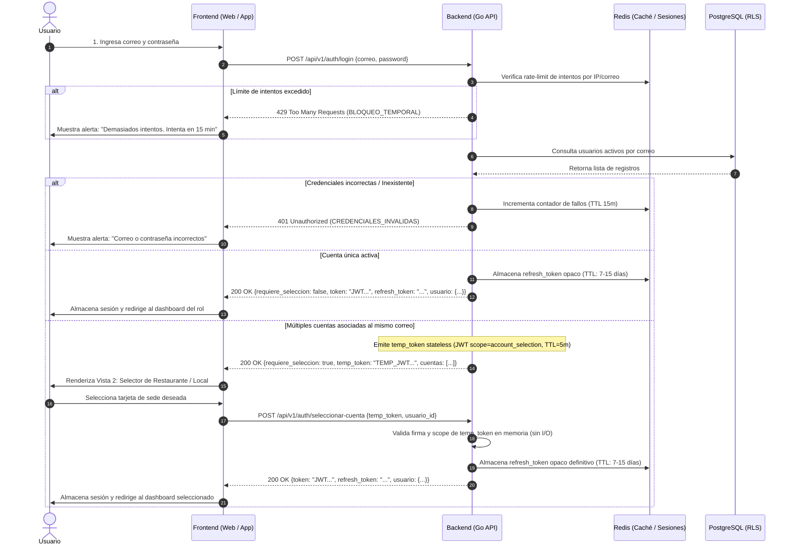
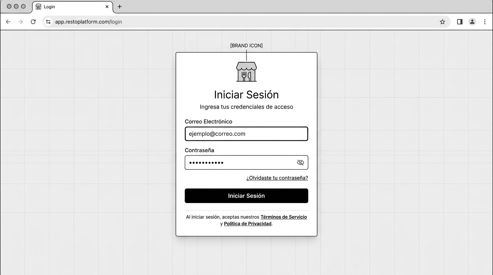
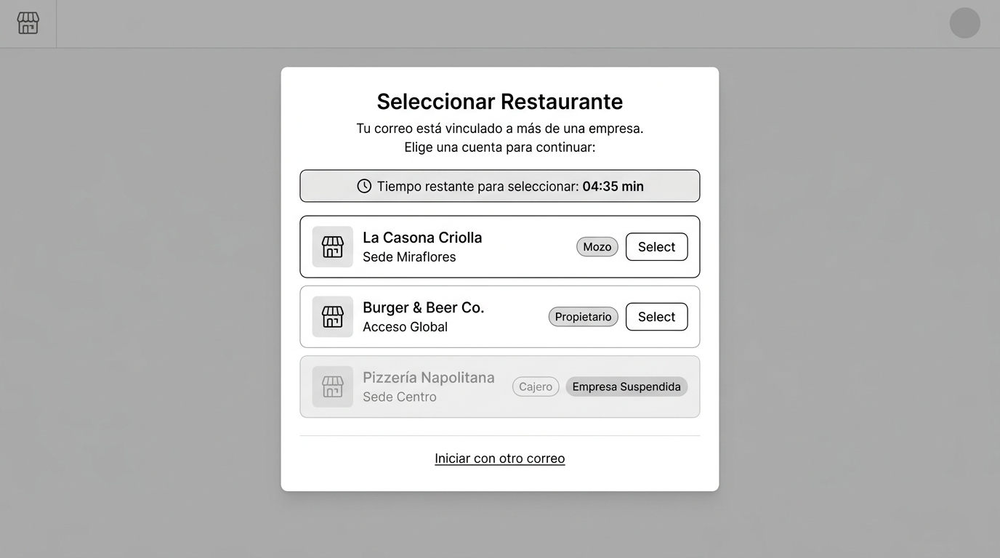

# CU-AUTH-01: Iniciar Sesión y Resolución Multi-Cuenta

Especificación técnica de interfaz de usuario, arquitectura de información, estados UX y contratos de API para el flujo transversal de autenticación en **RestaurantCloud AI**.

---

## 1. Ficha Técnica del Caso de Uso

| Atributo | Detalle |
| :--- | :--- |
| **Código CU** | `CU-AUTH-01` |
| **Nombre** | Iniciar sesión y resolución multi-cuenta |
| **Actor(es)** | `usuario` (transversal: Admin SaaS, Propietario, Admin Local, Mozo, Cocina, Cajero) |
| **Dispositivo / Viewport** | Responsive: Web Desktop (`1440x900`), Tablet (`768x1024`), Mobile (`375x812`) |
| **Precondición** | El usuario cuenta con al menos un registro en la tabla `usuario` |
| **Postcondición** | Token JWT emitido con claims de sesión (`usuario_id`, `empresa_id`, `local_id`, `rol`) y redirección al panel correspondiente |

---

## 2. Diagrama de Flujo y Secuencia



---

## 3. Wireframes Estructurales y Layout

> [!NOTE]
> El diseño se enfoca en distribución espacial, jerarquía de información y accesibilidad sin aplicar tokens de diseño cosméticos (paleta de colores ni tipografías de marca definitivas).

### 3.1 Vista 1: Formulario de Credenciales

#### Distribución Estructural (Layout ASCII)
```text
+-----------------------------------------------------------------------+
|  Browser / Viewport                                                   |
+-----------------------------------------------------------------------+
|                                                                       |
|                     +-----------------------------+                   |
|                     |        [LOGO / BRAND]       |                   |
|                     |                             |                   |
|                     |        Iniciar Sesión       |                   |
|                     | Ingresa tus credenciales... |                   |
|                     |                             |                   |
|                     | Correo Electrónico          |                   |
|                     | [ ejemplo@correo.com      ] |                   |
|                     |                             |                   |
|                     | Contraseña                  |                   |
|                     | [ *************       (o) ] |                   |
|                     |                             |                   |
|                     |   <¿Olvidaste contraseña?>  |                   |
|                     |                             |                   |
|                     | +-------------------------+ |                   |
|                     | |      INICIAR SESIÓN     | |                   |
|                     | +-------------------------+ |                   |
|                     |                             |                   |
|                     | Términos y Privacidad       |                   |
|                     +-----------------------------+                   |
|                                                                       |
+-----------------------------------------------------------------------+
```

#### Imagen Referencial del Wireframe


---

### 3.2 Vista 2: Selector de Restaurante / Cuenta

Esta vista se activa únicamente cuando el correo y contraseña coinciden con más de una cuenta (diferentes empresas o locales en el modelo multi-tenant).

#### Distribución Estructural (Layout ASCII)
```text
+-----------------------------------------------------------------------+
|  Modal / Contenedor Centrado                                          |
+-----------------------------------------------------------------------+
|                                                                       |
|                     +---------------------------------------+         |
|                     |        Seleccionar Restaurante        |         |
|                     | Tu correo está vinculado a más de una |         |
|                     | empresa. Elige con cuál continuar:    |         |
|                     |                                       |         |
|                     | +-----------------------------------+ |         |
|                     | | (Icono Reloj) Tiempo: 04:35 min   | |         |
|                     | +-----------------------------------+ |         |
|                     |                                       |         |
|                     | +-----------------------------------+ |         |
|                     | | (Icon) La Casona Criolla          | |         |
|                     | | Sede Miraflores    [Mozo] [Entrar]| |         |
|                     | +-----------------------------------+ |         |
|                     |                                       |         |
|                     | +-----------------------------------+ |         |
|                     | | (Icon) Burger & Beer Co.          | |         |
|                     | | Acceso Global [Propietario][Entrar| |         |
|                     | +-----------------------------------+ |         |
|                     |                                       |         |
|                     | +-----------------------------------+ |         |
|                     | | (Icon) Pizzería Napolitana        | |         |
|                     | | Sede Centro [Cajero] [SUSPENDIDA] | |         |
|                     | +-----------------------------------+ |         |
|                     |                                       |         |
|                     |       <Iniciar con otro correo>       |         |
|                     +---------------------------------------+         |
|                                                                       |
+-----------------------------------------------------------------------+
```

#### Imagen Referencial del Wireframe


---

## 4. Matriz de Estados UX (Casos Esperados e Inesperados)

| Estado | Pantalla 1: Credenciales | Pantalla 2: Selector de Cuenta |
| :--- | :--- | :--- |
| **1. Ideal (Happy Path)** | Inputs con autofocus en `correo`, botón submit habilitado tras validar formato. | Contador regresivo visible (`⏱️ 04:35 min`) sincronizado con `expira_en_segundos`. Tarjetas interactivas con nombre, local y badge de rol. Clic emite sesión. |
| **2. Vacío (Empty State)** | Formulario limpio al cargar por primera vez. | **Inesperado:** Todas las cuentas asociadas están desactivadas. Mensaje informativo: *"No tienes cuentas activas. Contacta a tu administrador"*, botón *"Volver"*. |
| **3. Carga (Loading)** | Botón submit deshabilitado con spinner de carga; inputs bloqueados para evitar doble submit. | Skeleton cards mientras el frontend procesa la respuesta del token temporal antes de iniciar el reloj. |
| **4. Error / Validación** | - Correo sin formato válido: Error inline bajo el campo antes del submit.<br>- Contraseña vacía: Error inline *"Ingresa tu contraseña"*.<br>- Credenciales no coinciden: Alerta general *"Correo o contraseña incorrectos"* (HTTP 401). | - **Expiración de tiempo (00:00):** Se desactivan las tarjetas y se muestra modal/overlay: *"El tiempo para seleccionar cuenta ha expirado"*, con botón *"Volver a iniciar sesión"*. Si se forzara la petición, el backend responde `401 TEMP_TOKEN_EXPIRADO`. |
| **5. Borde / Inesperado (Edge Cases)** | - **Fuerza bruta (HTTP 429):** *"Demasiados intentos fallidos. Bloqueado por 15 minutos"*.<br>- **Espacios accidentales en correo:** El frontend aplica `.trim().toLowerCase()` automáticamente.<br>- **Pérdida de conexión:** Alerta flotante *"Sin conexión a internet. Revisa tu red"*. | - **Alerta de tiempo crítico (< 60s):** El contador cambia a estado de advertencia (ámbar) avisando que la sesión cerrará pronto.<br>- **Empresa Suspendida (falta de pago Stripe):** Tarjeta atenuada con badge *"Empresa Suspendida"* (no cliqueable).<br>- **Múltiples sedes (> 5 cuentas):** Buscador interactivo por nombre de local. |

---

## 5. Contratos de API (Frontend ↔ Backend)

Todos los contratos respetan el estándar general del backend Go definido en [`context/mock.md`](file:///j:/proyectos_git/RestaurantCloud_AI_backend/context/mock.md).

### 5.1 Endpoint: Login con Credenciales

- **Método:** `POST`
- **Ruta:** `/api/v1/auth/login`
- **Autenticación:** Pública (sin token previo)

#### Request Payload
```json
{
  "correo": "carlos.huaman@ejemplo.com",
  "password": "PasswordSegura123!"
}
```

#### Response 200 OK — Caso A: Cuenta Única (Directo al Panel)
```json
{
  "exito": true,
  "datos": {
    "requiere_seleccion": false,
    "token": "eyJhbGciOiJIUzI1NiIsInR5cCI6IkpXVCJ9...",
    "refresh_token": "d7a8e9f0-b1c2-3d4e-5f6a-7b8c9d0e1f2a",
    "usuario": {
      "id": "a1b2c3d4-e5f6-7a8b-9c0d-1e2f3a4b5c6d",
      "nombre": "Carlos Huamán",
      "correo": "carlos.huaman@ejemplo.com",
      "rol": "mozo",
      "empresa": {
        "id": "e1f2a3b4-c5d6-7e8f-9a0b-1c2d3e4f5a6b",
        "nombre": "La Casona Criolla"
      },
      "local": {
        "id": "l1a2b3c4-d5e6-7f8a-9b0c-1d2e3f4a5b6c",
        "nombre": "Sede Miraflores"
      }
    }
  },
  "meta": {
    "timestamp": "2026-10-01T12:00:00Z"
  }
}
```

#### Response 200 OK — Caso B: Múltiples Cuentas (Requiere Selector)
```json
{
  "exito": true,
  "datos": {
    "requiere_seleccion": true,
    "temp_token": "eyJhbGciOiJIUzI1NiIsInR5cCI6IkpXVCJ9.TEMP_SELECTION_TOKEN...",
    "expira_en_segundos": 300,
    "cuentas": [
      {
        "usuario_id": "a1b2c3d4-e5f6-7a8b-9c0d-1e2f3a4b5c6d",
        "empresa_id": "e1f2a3b4-c5d6-7e8f-9a0b-1c2d3e4f5a6b",
        "empresa_nombre": "La Casona Criolla",
        "local_id": "l1a2b3c4-d5e6-7f8a-9b0c-1d2e3f4a5b6c",
        "local_nombre": "Sede Miraflores",
        "rol": "mozo",
        "estado_empresa": "activa",
        "acceso_habilitado": true
      },
      {
        "usuario_id": "b2c3d4e5-f6a7-8b9c-0d1e-2f3a4b5c6d7e",
        "empresa_id": "e2f3a4b5-c6d7-8e9f-0a1b-2c3d4e5f6a7b",
        "empresa_nombre": "Burger & Beer Co.",
        "local_id": null,
        "local_nombre": "Acceso Global",
        "rol": "propietario",
        "estado_empresa": "activa",
        "acceso_habilitado": true
      },
      {
        "usuario_id": "c3d4e5f6-a7b8-9c0d-1e2f-3a4b5c6d7e8f",
        "empresa_id": "e3f4a5b6-c7d8-9e0f-1a2b-3c4d5e6f7a8b",
        "empresa_nombre": "Pizzería Napolitana",
        "local_id": "l2b3c4d5-e6f7-8a9b-0c1d-2e3f4a5b6c7d",
        "local_nombre": "Sede Centro",
        "rol": "cajero",
        "estado_empresa": "suspendida",
        "acceso_habilitado": false,
        "motivo_bloqueo": "Suscripción suspendida por falta de pago"
      }
    ]
  },
  "meta": {
    "timestamp": "2026-10-01T12:00:00Z"
  }
}
```

---

### 5.2 Endpoint: Seleccionar Cuenta

- **Método:** `POST`
- **Ruta:** `/api/v1/auth/seleccionar-cuenta`
- **Headers:** `Authorization: Bearer <temp_token>`

#### Request Payload
```json
{
  "usuario_id": "a1b2c3d4-e5f6-7a8b-9c0d-1e2f3a4b5c6d"
}
```

#### Response 200 OK — Emisión del Token Definitivo
```json
{
  "exito": true,
  "datos": {
    "token": "eyJhbGciOiJIUzI1NiIsInR5cCI6IkpXVCJ9.FINAL_SESSION_JWT...",
    "refresh_token": "d7a8e9f0-b1c2-3d4e-5f6a-7b8c9d0e1f2a",
    "usuario": {
      "id": "a1b2c3d4-e5f6-7a8b-9c0d-1e2f3a4b5c6d",
      "nombre": "Carlos Huamán",
      "correo": "carlos.huaman@ejemplo.com",
      "rol": "mozo",
      "empresa": {
        "id": "e1f2a3b4-c5d6-7e8f-9a0b-1c2d3e4f5a6b",
        "nombre": "La Casona Criolla"
      },
      "local": {
        "id": "l1a2b3c4-d5e6-7f8a-9b0c-1d2e3f4a5b6c",
        "nombre": "Sede Miraflores"
      }
    }
  },
  "meta": {
    "timestamp": "2026-10-01T12:01:00Z"
  }
}
```

---

### 5.3 Catálogo de Errores Específicos

| HTTP Status | Código de Error (`apiresponse.ErrorDetail.Codigo`) | Mensaje al Usuario | Causa / Manejo UX |
| :--- | :--- | :--- | :--- |
| `400 Bad Request` | `CAMPOS_REQUERIDOS` | "El correo y la contraseña son obligatorios" | Validación de campos vacíos en el servidor |
| `401 Unauthorized` | `CREDENCIALES_INVALIDAS` | "Correo o contraseña incorrectos" | Contraseña errónea o correo no registrado (mensaje neutral anti-enumeración) |
| `401 Unauthorized` | `TEMP_TOKEN_EXPIRADO` | "La sesión de selección ha expirado" | El usuario tardó más de 5 min en elegir cuenta; se le devuelve a la pantalla 1 |
| `403 Forbidden` | `EMPRESA_SUSPENDIDA` | "El acceso a esta empresa se encuentra suspendido" | Se intentó forzar la selección de una empresa suspendida |
| `403 Forbidden` | `USUARIO_INACTIVO` | "Tu usuario se encuentra desactivado" | El administrador del local dio de baja a este usuario |
| `429 Too Many Requests` | `DEMASIADOS_INTENTOS` | "Demasiados intentos fallidos. Intenta nuevamente en 15 minutos" | Límite de rate limiting alcanzado |

---

## 6. Estructuras Go Sugeridas (Backend DTOs)

```go
package authdto

import "github.com/google/uuid"

// LoginRequest contiene las credenciales de entrada
type LoginRequest struct {
    Correo   string `json:"correo" binding:"required,email"`
    Password string `json:"password" binding:"required"`
}

// CuentaItemDTO representa una de las opciones en caso de multi-cuenta
type CuentaItemDTO struct {
    UsuarioID        uuid.UUID  `json:"usuario_id"`
    EmpresaID        uuid.UUID  `json:"empresa_id"`
    EmpresaNombre    string     `json:"empresa_nombre"`
    LocalID          *uuid.UUID `json:"local_id"`
    LocalNombre      string     `json:"local_nombre"`
    Rol              string     `json:"rol"`
    EstadoEmpresa    string     `json:"estado_empresa"`
    AccesoHabilitado bool       `json:"acceso_habilitado"`
    MotivoBloqueo    string     `json:"motivo_bloqueo,omitempty"`
}

// LoginResponseDTO respuesta de login (bifurcada)
type LoginResponseDTO struct {
    RequiereSeleccion bool            `json:"requiere_seleccion"`
    Token             string          `json:"token,omitempty"`
    RefreshToken      string          `json:"refresh_token,omitempty"`
    TempToken         string          `json:"temp_token,omitempty"`
    ExpiraEnSegundos  int             `json:"expira_en_segundos,omitempty"` // Tiempo de vigencia del temp_token
    Usuario           *UsuarioAuthDTO `json:"usuario,omitempty"`
    Cuentas           []CuentaItemDTO `json:"cuentas,omitempty"`
}

// SeleccionarCuentaRequest solicita token final para una cuenta específica
type SeleccionarCuentaRequest struct {
    UsuarioID uuid.UUID `json:"usuario_id" binding:"required"`
}

type UsuarioAuthDTO struct {
    ID      uuid.UUID       `json:"id"`
    Nombre  string          `json:"nombre"`
    Correo  string          `json:"correo"`
    Rol     string          `json:"rol"`
    Empresa EmpresaBasicDTO `json:"empresa"`
    Local   *LocalBasicDTO  `json:"local,omitempty"`
}

type EmpresaBasicDTO struct {
    ID     uuid.UUID `json:"id"`
    Nombre string    `json:"nombre"`
}

type LocalBasicDTO struct {
    ID     uuid.UUID `json:"id"`
    Nombre string    `json:"nombre"`
}
```

---

## 7. Consideraciones de Seguridad y Multi-tenancy

1. **Anti-enumeración de usuarios:** La respuesta ante un correo inexistente o contraseña equivocada debe tardar el mismo tiempo de hash (`bcrypt.CompareHashAndPassword`) y devolver idéntico código de error (`CREDENCIALES_INVALIDAS`).
2. **Aislamiento en Selección de Cuenta (Stateless JWT):** El `temp_token` es un JWT firmado con un `scope: "account_selection"`, tiempo de expiración corto (3 a 5 minutos) y el listado de `cuentas_permitidas` en sus claims. No requiere almacenamiento en base de datos ni en Redis; el backend valida su firma criptográfica en memoria CPU. Si un cliente intenta usarlo en cualquier otro endpoint de negocio, el middleware de autenticación lo rechazará con `401 Unauthorized`.
3. **Inyección de Tenant para RLS:** Una vez emitido el JWT final con el `empresa_id` definitivo, el middleware de negocio de Go ejecutará en PostgreSQL antes de cada query:
   ```sql
   SET LOCAL app.tenant_id = '<empresa_id>';
   ```
   asegurando que ninguna consulta posterior filtre datos fuera de la empresa seleccionada.
4. **Gestión de Refresh Tokens y Cierre de Sesión (Redis):**
   - El `refresh_token` es una cadena opaca de 32 bytes criptográficamente seguros (`crypto/rand`) almacenada en **Redis** bajo la clave `auth:refresh:<usuario_id>:<token_hash>` con un TTL de 7 a 15 días.
   - Al invocar `/api/v1/auth/refresh`, el backend verifica la existencia en Redis, invalida el token actual y emite uno nuevo (rotación de refresh tokens).
   - Al invocar `/api/v1/auth/logout`, el refresh token se elimina de Redis de inmediato, y el `jti` del Access Token se agrega a `auth:blacklist:<jti>` con un TTL residual igual a su vigencia restante, impidiendo su reutilización.
   - Ninguna de estas operaciones efímeras toca PostgreSQL, eliminando la sobrecarga por tuplas muertas (*dead tuples*).
5. **Mitigación de Fuerza Bruta (Rate Limiting en Redis):**
   - Cada intento fallido incrementa un contador en Redis bajo `ratelimit:login:<ip_o_correo>` con ventana deslizante o TTL de 15 minutos.
   - Al alcanzar el umbral máximo de intentos consecutivos (ej. 5 intentos), el backend responde `429 Too Many Requests` sin realizar consultas de base de datos ni cálculo de hash de contraseña.
