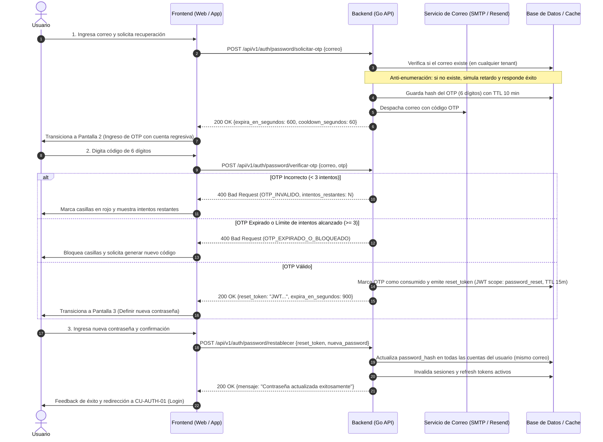
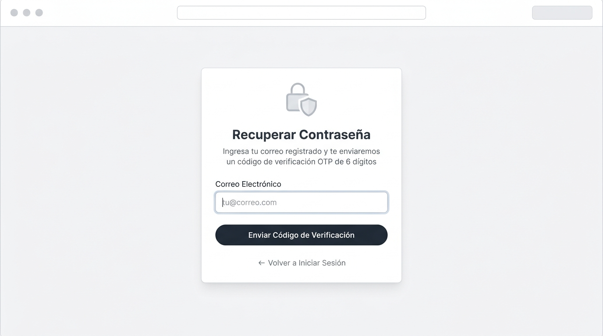
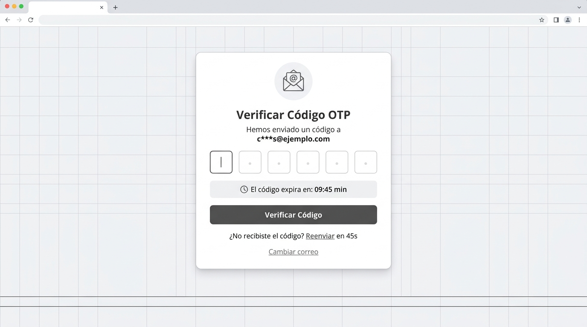
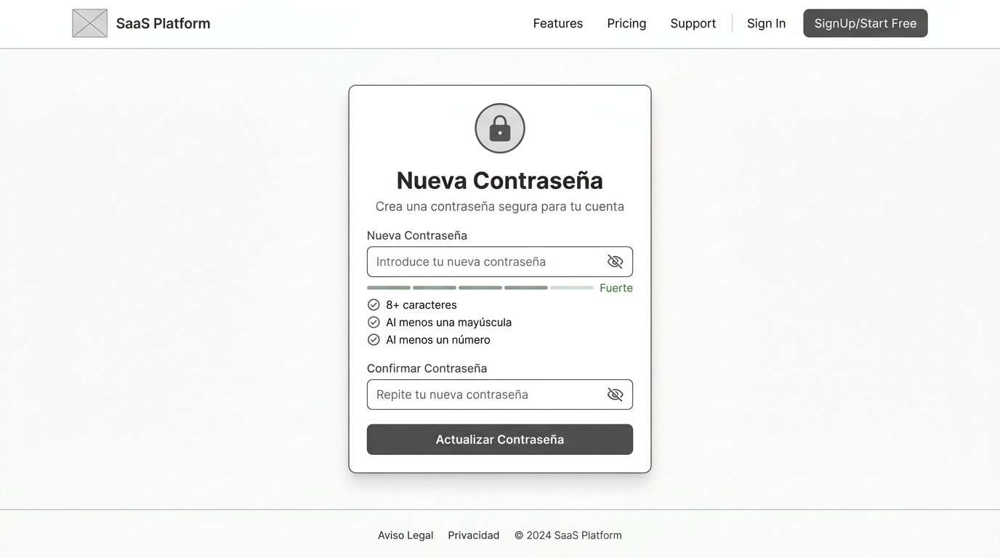

# CU-AUTH-02: Recuperación de Contraseña mediante Código OTP por Correo

Especificación técnica de interfaz de usuario, arquitectura de información, estados UX y contratos de API para el flujo transversal de recuperación de credenciales en **RestaurantCloud AI**.

---

## 1. Ficha Técnica del Caso de Uso

| Atributo | Detalle |
| :--- | :--- |
| **Código CU** | `CU-AUTH-02` |
| **Nombre** | Recuperar contraseña mediante código OTP por correo |
| **Actor(es)** | `usuario` (transversal a todos los actores del sistema) |
| **Dispositivo / Viewport** | Responsive: Web Desktop (`1440x900`), Tablet (`768x1024`), Mobile (`375x812`) |
| **Precondición** | El usuario tiene al menos una cuenta registrada y no recuerda su contraseña |
| **Postcondición** | Se actualiza la contraseña (`password_hash`), se revocan tokens previos y se redirige al login |

---

## 2. Diagrama de Flujo y Secuencia



---

## 3. Wireframes Estructurales y Layout

> [!NOTE]
> El diseño se enfoca en distribución espacial, jerarquía de información y accesibilidad sin aplicar tokens de diseño cosméticos (paleta de colores ni tipografías de marca definitivas).

---

### 3.1 Paso 1: Solicitud de Código OTP

#### Distribución Estructural (Layout ASCII)
```text
+-----------------------------------------------------------------------+
|  Browser / Viewport                                                   |
+-----------------------------------------------------------------------+
|                                                                       |
|                     +-----------------------------+                   |
|                     |      [ICONO CANDADO]        |                   |
|                     |                             |                   |
|                     |    Recuperar Contraseña     |                   |
|                     | Ingresa tu correo regist... |                   |
|                     |                             |                   |
|                     | Correo Electrónico          |                   |
|                     | [ tu@correo.com           ] |                   |
|                     |                             |                   |
|                     | +-------------------------+ |                   |
|                     | | ENVIAR CÓDIGO DE VERIF. | |                   |
|                     | +-------------------------+ |                   |
|                     |                             |                   |
|                     |  <-- Volver a Iniciar Sesión|                   |
|                     +-----------------------------+                   |
|                                                                       |
+-----------------------------------------------------------------------+
```

#### Imagen Referencial del Wireframe


---

### 3.2 Paso 2: Verificación de Código OTP

#### Distribución Estructural (Layout ASCII)
```text
+-----------------------------------------------------------------------+
|  Browser / Viewport                                                   |
+-----------------------------------------------------------------------+
|                                                                       |
|                     +---------------------------------------+         |
|                     |            [ICONO SOBRE]              |         |
|                     |                                       |         |
|                     |         Verificar Código OTP          |         |
|                     | Hemos enviado un código a:            |         |
|                     | c***s@ejemplo.com                     |         |
|                     |                                       |         |
|                     |  [ 4 ] [ 8 ] [ 1 ] [ 9 ] [ 2 ] [ 0 ]  |         |
|                     |                                       |         |
|                     | +-----------------------------------+ |         |
|                     | | (Reloj) El código expira: 09:45 m | |         |
|                     | +-----------------------------------+ |         |
|                     |                                       |         |
|                     | +-----------------------------------+ |         |
|                     | |         VERIFICAR CÓDIGO          | |         |
|                     | +-----------------------------------+ |         |
|                     |                                       |         |
|                     | ¿No recibiste el código? Reenviar en  |         |
|                     |                   (45s)               |         |
|                     |             <Cambiar correo>          |         |
|                     +---------------------------------------+         |
|                                                                       |
+-----------------------------------------------------------------------+
```

#### Imagen Referencial del Wireframe


---

### 3.3 Paso 3: Restablecer Contraseña

#### Distribución Estructural (Layout ASCII)
```text
+-----------------------------------------------------------------------+
|  Browser / Viewport                                                   |
+-----------------------------------------------------------------------+
|                                                                       |
|                     +---------------------------------------+         |
|                     |            [ICONO ESCUDO]             |         |
|                     |                                       |         |
|                     |            Nueva Contraseña           |         |
|                     | Crea una contraseña segura...         |         |
|                     |                                       |         |
|                     | Nueva Contraseña                      |         |
|                     | [ *************                 (o) ] |         |
|                     | [====     ] Nivel: Medio              |         |
|                     |                                       |         |
|                     | (v) Mínimo 8 caracteres               |         |
|                     | (v) Al menos una mayúscula            |         |
|                     | (v) Al menos un número                |         |
|                     |                                       |         |
|                     | Confirmar Contraseña                  |         |
|                     | [ *************                 (o) ] |         |
|                     |                                       |         |
|                     | +-----------------------------------+ |         |
|                     | |       ACTUALIZAR CONTRASEÑA       | |         |
|                     | +-----------------------------------+ |         |
|                     +---------------------------------------+         |
|                                                                       |
+-----------------------------------------------------------------------+
```

#### Imagen Referencial del Wireframe


---

## 4. Matriz de Estados UX (Casos Esperados e Inesperados)

| Estado | Paso 1: Solicitar OTP | Paso 2: Verificar OTP | Paso 3: Nueva Contraseña |
| :--- | :--- | :--- | :--- |
| **1. Ideal (Happy Path)** | Input con autofocus. Formato válido habilita botón. | El usuario digita o pega (*clipboard paste*) los 6 dígitos. Avanza automáticamente al 6to dígito. | Inputs con validación reactiva de reglas. Botón habilitado solo cuando ambas coinciden y cumplen requisitos. |
| **2. Vacío (Empty State)** | Input en blanco con placeholder sugerido. | Casillas vacías; foco en la primera casilla. | Campos en blanco; checklist de requisitos en estado inactivo. |
| **3. Carga (Loading)** | Botón disabled con spinner *"Enviando código..."*. | Botón disabled con spinner *"Verificando..."*; casillas bloqueadas temporalmente. | Botón disabled con spinner *"Actualizando contraseña..."*. |
| **4. Error / Validación** | - Formato de correo no válido (error inline bajo el input). | - **Código erróneo:** Sacudida visual (*shake animation*), casillas en rojo: *"Código incorrecto. Te quedan 2 intentos"*.<br>- **OTP Expirado:** Banner rojo *"Código vencido"*. Se habilita botón *"Solicitar nuevo código"*. | - **Contraseñas no coinciden:** Error inline *"Las contraseñas deben ser iguales"*.<br>- **No cumple requisitos:** Indicadores visuales en rojo en los ítems faltantes. |
| **5. Borde / Inesperado (Edge Cases)** | - **Anti-enumeración:** Si el correo no existe en la BD, se muestra idéntico mensaje de éxito para evitar que atacantes descubran correos registrados.<br>- **Rate limiting anti-spam:** Máximo 3 solicitudes por IP/correo cada 15 min (HTTP 429). | - **Intento de fuerza bruta:** Al 3er fallo consecutivo, el OTP se invalida de inmediato: *"Demasiados intentos fallidos. Genera un nuevo código"*.<br>- **Cooldown de reenvío:** Botón *"Reenviar código"* bloqueado con cuenta regresiva de 60s.<br>- **Pegado de texto:** Si el usuario copia `481920` y presiona Ctrl+V en la 1ra casilla, el frontend auto-distribuye los caracteres en las 6 casillas. | - **Token de reseteo expirado (> 15 min):** Si el usuario tarda demasiado en escribir su nueva clave: *"Tu sesión de restablecimiento expiró"*. Redirige al Paso 1.<br>- **Múltiples cuentas por correo:** El backend actualiza la clave en todas las empresas donde el usuario esté dado de alta con ese mismo correo. |

---

## 5. Contratos de API (Frontend ↔ Backend)

Todos los contratos respetan el estándar general del backend Go definido en [`context/mock.md`](file:///j:/proyectos_git/RestaurantCloud_AI_backend/context/mock.md).

---

### 5.1 Endpoint 1: Solicitar Código OTP

- **Método:** `POST`
- **Ruta:** `/api/v1/auth/password/solicitar-otp`
- **Autenticación:** Pública

#### Request Payload
```json
{
  "correo": "carlos.huaman@ejemplo.com"
}
```

#### Response 200 OK
```json
{
  "exito": true,
  "datos": {
    "mensaje": "Si el correo está registrado, recibirás un código de verificación en breve.",
    "correo_enmascarado": "c***s@ejemplo.com",
    "expira_en_segundos": 600,
    "cooldown_reenvio_segundos": 60
  },
  "meta": {
    "timestamp": "2026-10-01T12:00:00Z"
  }
}
```

---

### 5.2 Endpoint 2: Verificar Código OTP

- **Método:** `POST`
- **Ruta:** `/api/v1/auth/password/verificar-otp`
- **Autenticación:** Pública

#### Request Payload
```json
{
  "correo": "carlos.huaman@ejemplo.com",
  "otp": "481920"
}
```

#### Response 200 OK (Código Válido)
```json
{
  "exito": true,
  "datos": {
    "reset_token": "eyJhbGciOiJIUzI1NiIsInR5cCI6IkpXVCJ9.RESET_PASSWORD_TOKEN...",
    "expira_en_segundos": 900
  },
  "meta": {
    "timestamp": "2026-10-01T12:01:00Z"
  }
}
```

---

### 5.3 Endpoint 3: Restablecer Contraseña

- **Método:** `POST`
- **Ruta:** `/api/v1/auth/password/restablecer`
- **Headers:** `Authorization: Bearer <reset_token>`

#### Request Payload
```json
{
  "nueva_password": "NuevaPasswordSegura2026!"
}
```

#### Response 200 OK
```json
{
  "exito": true,
  "datos": {
    "mensaje": "Tu contraseña ha sido actualizada exitosamente. Ya puedes iniciar sesión con tus nuevas credenciales."
  },
  "meta": {
    "timestamp": "2026-10-01T12:02:00Z"
  }
}
```

---

### 5.4 Catálogo de Errores Específicos

| HTTP Status | Código de Error (`apiresponse.ErrorDetail.Codigo`) | Mensaje al Usuario | Causa / Manejo UX |
| :--- | :--- | :--- | :--- |
| `400 Bad Request` | `CORREO_INVALIDO` | "El correo electrónico no tiene un formato válido" | Validación sintáctica previa |
| `400 Bad Request` | `OTP_INVALIDO` | "El código ingresado es incorrecto" | Código no coincide con el hash generado; decrementa intentos disponibles |
| `400 Bad Request` | `OTP_EXPIRADO` | "El código de verificación ha expirado" | Transcurrieron los 10 minutos de validez; usuario debe solicitar reenvío |
| `400 Bad Request` | `OTP_BLOQUEADO_INTENTOS` | "Demasiados intentos fallidos. Solicita un nuevo código" | Se superaron los 3 intentos fallidos; el OTP actual queda anulado |
| `400 Bad Request` | `PASSWORD_DEBIL` | "La contraseña debe tener al menos 8 caracteres, una mayúscula y un número" | No satisface las reglas de complejidad |
| `401 Unauthorized` | `RESET_TOKEN_INVALIDO` | "La sesión de restablecimiento no es válida o ha expirado" | El JWT de reseteo caducó (> 15 min); redirigir al paso 1 |
| `429 Too Many Requests` | `COOLDOWN_ACTIVO` | "Espera unos segundos antes de solicitar otro código" | Se intentó reenviar antes de culminar los 60s de cooldown |
| `429 Too Many Requests` | `DEMASIADAS_SOLICITUDES` | "Has superado el límite de solicitudes. Intenta en 15 minutos" | Protección contra abusos de envío de correos |

---

## 6. Estructuras Go Sugeridas (Backend DTOs)

```go
package authdto

// SolicitarOTPRequest entrada para solicitar código
type SolicitarOTPRequest struct {
    Correo string `json:"correo" binding:"required,email"`
}

// SolicitarOTPResponseDTO respuesta con metadatos del temporizador
type SolicitarOTPResponseDTO struct {
    Mensaje                 string `json:"mensaje"`
    CorreoEnmascarado       string `json:"correo_enmascarado"`
    ExpiraEnSegundos        int    `json:"expira_en_segundos"`          // ej. 600 (10 min)
    CooldownReenvioSegundos int    `json:"cooldown_reenvio_segundos"` // ej. 60 (1 min)
}

// VerificarOTPRequest entrada para validar el código recibido
type VerificarOTPRequest struct {
    Correo string `json:"correo" binding:"required,email"`
    OTP    string `json:"otp" binding:"required,len=6,numeric"`
}

// VerificarOTPResponseDTO emite el token de reseteo
type VerificarOTPResponseDTO struct {
    ResetToken       string `json:"reset_token"`
    ExpiraEnSegundos int    `json:"expira_en_segundos"` // ej. 900 (15 min)
}

// RestablecerPasswordRequest define la nueva contraseña
type RestablecerPasswordRequest struct {
    NuevaPassword string `json:"nueva_password" binding:"required,min=8"`
}

// RestablecerPasswordResponseDTO confirmación final
type RestablecerPasswordResponseDTO struct {
    Mensaje string `json:"mensaje"`
}
```

---

## 7. Consideraciones de Seguridad y Multi-tenancy

1. **Anti-enumeración de usuarios:** Cuando se consulta un correo que no existe en la base de datos, el backend ejecuta un delay simulado (ej. `crypto/rand` hash dummy) y retorna exactamente el mismo `200 OK` con un correo enmascarado ficticio. De este modo, un atacante no puede deducir qué correos están registrados en la plataforma.
2. **Generación Criptográfica y Almacenamiento del OTP:**
   - El código se genera con `crypto/rand` (números del `000000` al `999999`).
   - El backend **nunca almacena el OTP en texto plano**. Se almacena su hash `sha256(otp + salt)` en memoria caché (Redis) o en una tabla `otp_recuperacion` con TTL de 10 minutos y contador de intentos (`intentos_fallidos`).
3. **Aislamiento del `reset_token`:** El token generado en el paso 2 es un JWT firmado con un `scope: "password_reset"` y contiene el `correo` verificado. No otorga acceso a ningún endpoint de negocio (rechazado por el middleware de autenticación operativa).
4. **Sincronización Multi-tenant:** Dado que el correo puede pertenecer a más de una empresa (`UNIQUE(empresa_id, correo)`), al verificarse el OTP sobre la casilla de correo real, el backend ejecuta una transacción SQL:
   ```sql
   UPDATE usuario
   SET password_hash = :nuevo_hash
   WHERE correo = :correo;
   ```
   asegurando que todas las cuentas asociadas a esa persona queden actualizadas simultáneamente sin inconsistencias ni contraseñas huérfanas.
